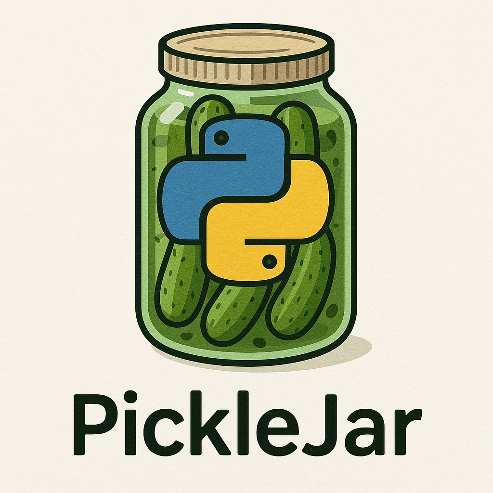

[](https://github.com/isaiah1112/picklejar/actions/workflows/lint_and_test.yml)

PickleJar stores one or more Python objects as pickles in a single file (a
"jar") and reads them back in order. It uses [`dill`] for serialization.

## Compatibility

PickleJar supports Python 3.11 through 3.15.

## Installation

Install the package from PyPI:

```console
python -m pip install picklejar
```

## Quick start

Create a jar and write objects to it:

```python
from picklejar import Jar

jar = Jar("data.jar")
jar.dump(["first object", {"answer": 42}], new_jar=True)
```

By default, `dump()` appends to an existing jar. Pass `new_jar=True` to
overwrite it. Lists and tuples are written as separate pickle objects by
default; pass `collapse=True` to store a list or tuple as one object instead.

Read the objects back in order:

```python
objects = jar.load()
print(objects)  # ["first object", {"answer": 42}]
```

`load()` returns the object itself when the jar contains exactly one pickle,
and a list when it contains zero or multiple pickles. Use `always_list=True` to
always receive a list, including when there is only one pickle. `Jar` also
accepts `pathlib.Path` paths and supports `exists()` and `remove()` for basic
file management.

> **Warning:** Pickle files can execute code when loaded. Only load jars from
> sources you trust.

## Documentation

See the [documentation on Read the Docs](https://picklejar.readthedocs.io/).

## Development

Clone the repository and install the package:

```console
make install
```

Run the test suite, linting, and type checks:

```console
make test
make lint
```

To run tests in Docker across the supported Python versions, install and start
[Docker](https://www.docker.com/) and run:

```console
make docker-test-all
```

Contributions are welcome. Please submit pull requests to the **develop**
branch. Report bugs and feature requests through the
[GitHub issue tracker](https://github.com/isaiah1112/picklejar/issues), with a
minimal reproducing example and traceback when applicable.

## License

PickleJar is released under the [GNU Lesser General Public License v3.0 or
later](./LICENSE) (see [LICENSE.lesser](./LICENSE.lesser) for the license text).

[`dill`]: https://pypi.org/project/dill/
